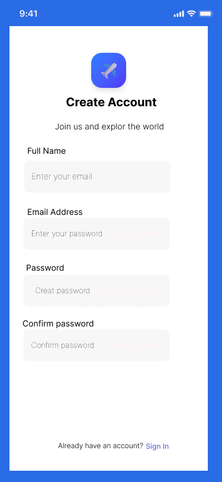
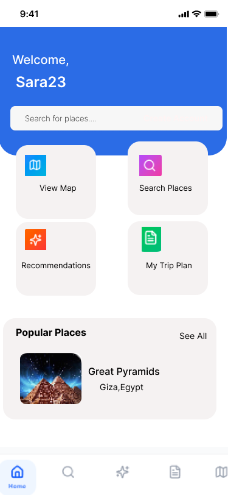
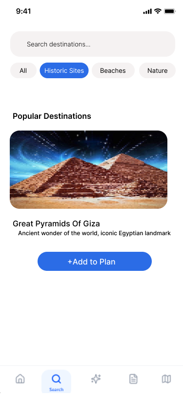
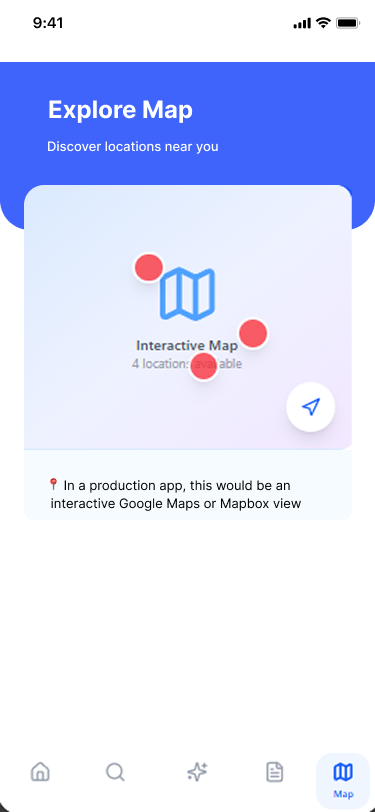
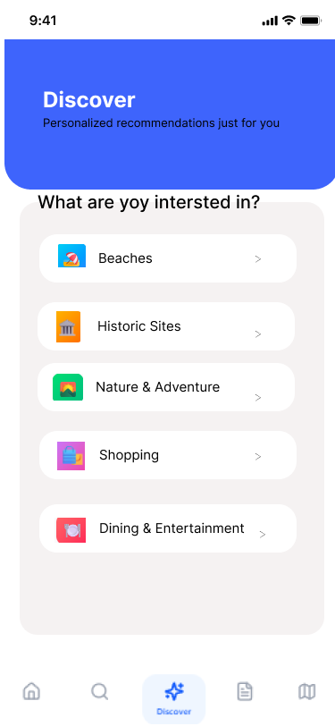
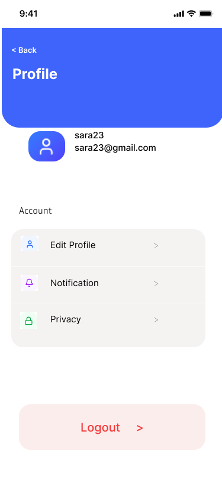

# Figma UI/UX — Smart Tourism App

UI design for the **Smart Tourism System**, an app that helps tourists discover places, plan trips and get recommendations. The PHP implementation is in [`php Projects`](../php%20Projects/).

| Screen | Preview |
|---|---|
| Login |  |
| Register |  |
| Home |  |
| Home (variant) |  |
| Search |  |
| Map |  |
| Trip plan |  |
| Recommendations |  |
| Profile |  |
